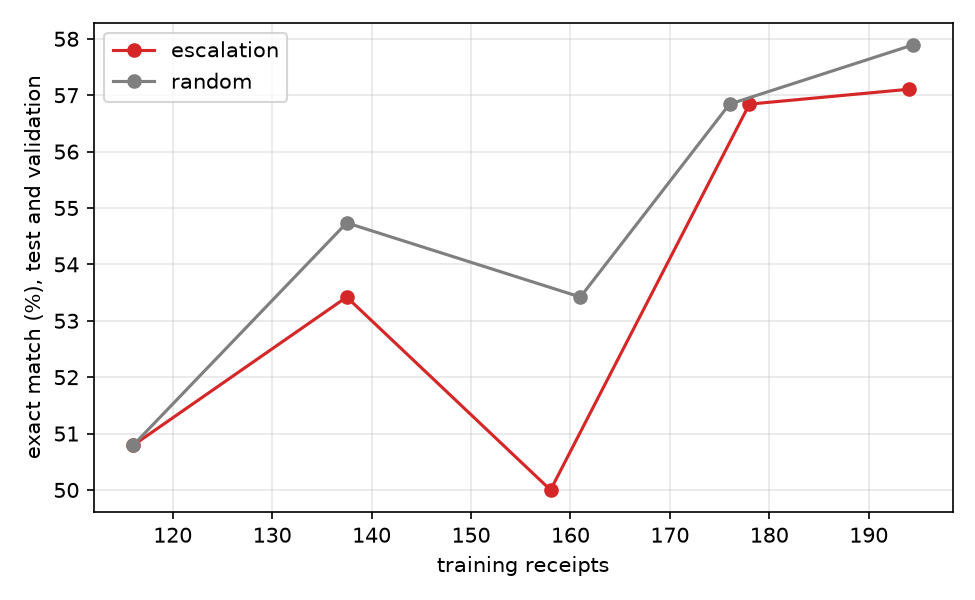

# receipt-router

Receipt text goes in and structured fields come out: line items, subtotal, tax, total. A small fine-tuned model does the reading. If its answer fails simple arithmetic checks, the receipt goes to a much bigger model instead.

Everything here ran on free tiers: Groq's free API for the big model, Kaggle's free GPU for training, and an ordinary laptop for inference. Nothing cost money.

## Headline numbers

Measured on 94 held-out receipts from CORD-v2. "Exact" means every extracted field matches the gold label.

| System | Exact match | Receipts answered without the big model |
|---|---|---|
| Big model (gpt-oss-120b) on every receipt | 61.7% | 0% |
| Small model, 4-bit file for CPU (Q5_K_M) | 62.8% | 100% |
| Small model plus router | 64.9% | 81% |

With 94 receipts none of these gaps is statistically meaningful (router vs big model: +3.2 points, interval -4.3 to +10.6). What the numbers do support is narrower: the small model is in the same range as the big one, and the router uses about 22% of the big model's tokens.

## Three things I found

1. Checking the big model's labels with arithmetic rules matters. Its answers that pass the checks are right far more often than the rest (81% exact against 62% overall), so I trained the small model only on the ones that pass.
2. Sending hard receipts back to the big model and training on them did not beat training on random receipts. That experiment is in the feedback loop section.
3. On a different kind of receipt (Malaysian, prices written like 9.00) the small model's total accuracy fell from 99% to 13%, and the arithmetic checks accepted most of the wrong answers. A monitor that needs no labels noticed the change after about 20 receipts.

The numbers come from the files in `results/` and from the scripts in `scripts/`.

## How it works

### Data

CORD-v2 from Hugging Face (`naver-clova-ix/cord-v2`): photos of Indonesian receipts with annotations, split 800 train, 100 validation, 100 test. I use the annotation lines, joined into plain text, as the input. A real deployment would get text from an OCR engine. I did not test that, so the numbers describe reading clean text, not reading photos.

29 of the 800 training receipts and 6 of the 100 test receipts are unusable (no total, or items without names) and are left out.

Each receipt becomes a small schema: a list of items (name, quantity, price, discount) plus subtotal, discount, service, tax and total.

### The checks

A few arithmetic rules decide whether an answer looks believable:

- the item prices (minus item discounts) add up to the subtotal, or to the total on tax-inclusive receipts
- subtotal, minus discount, plus service, plus tax equals the total
- there is a total, at least one item, and no blank item names

I allow a small tolerance (0.05% of the total) for rounding. On the usable training receipts, the gold labels themselves pass 730 of 771 (94.7%). The rest are annotation quirks. I did not bend the rules to fit them.

### The big model (teacher)

`openai/gpt-oss-120b` through Groq's free tier, with one worked example in the prompt. The first prompt misread tax lines as discounts and item-count lines as item names, so I rewrote it. On the same 94 test receipts, exact match went from 39.4% to 59.6% and tax from 77.7% to 96.8%. Those numbers were taken before I fixed a bug in how I parsed the gold labels, which later moved the second prompt to 61.7%.

I wrote the second prompt after reading the first one's errors on the test split, so the test score is a little optimistic. I also ran it on the validation split, which I had not looked at: 66.7% exact, and about 82% of answers passed the checks.

### The small model (student)

`Qwen2.5-1.5B-Instruct`, fine-tuned with QLoRA (rank 16) using Unsloth on a free Kaggle T4. Three epochs take 6 to 8 minutes. The training data is the big model's labels on the 771 labeled training receipts: 590 passed the checks, 770 could be parsed. I trained one student on each set to see whether the filtering helps.

### Router and service

The student answers first. If the answer fails the checks, the receipt goes to the big model. A cap on big-model calls per hour keeps a public demo from using up the free quota. The service is a small FastAPI app:

```
python -m uvicorn receipts.server:app --port 8000
```

There is no live demo. On Hugging Face's free tier, Docker and CPU Spaces are paid, and the free option is a GPU-sharing Space that does not fit a CPU model.

### Layout

- `src/receipts/` the library: schema, parsing, checks, teacher client, router, API
- `scripts/` data preparation, labeling, scoring, comparison and report scripts
- `notebooks/` Kaggle notebooks for training, quantizing and the feedback experiment
- `results/` the raw results of the experiments

## Results

### Big model and small model

94 test receipts.

| | Big model | Small model, trained on checked labels (590) | Small model, trained on all labels (770) |
|---|---|---|---|
| Exact match | 61.7% | 66.0% | 62.8% |
| Items F1 | 86.4% | 88.7% | 84.8% |
| Answers that pass the checks | 74.5% | 85.1% | 76.6% |

The paired differences are small next to the noise: checked student minus big model is +4.3 points (interval -5.3 to +13.8), and checked minus unchecked is +3.2 (interval -5.3 to +11.7). So I cannot say the small model beats the big one, and I did not show that filtering improves exact match. The one clear sign for filtering is how often the answers pass the checks, 85% against 77%, which matters because the router depends on it.

### Shrinking it for CPU

| File | Size | Exact match | Median seconds per receipt |
|---|---|---|---|
| Q4_K_M | 0.99 GB | 56.4% | 7.2 |
| Q5_K_M | 1.13 GB | 62.8% | 9.1 |
| Q8_0 | 1.65 GB | 61.7% | 9.8 |

Speeds are from Kaggle's 4 CPU threads. Q4 lost 9.6 points against the unquantized model (interval -18.1 to 0.0), which is probably real. Q5 and Q8 cannot be told apart, so I deployed Q5_K_M. On my own Windows laptop the sample receipt took about 7 seconds. A free Hugging Face Space has only 2 cores, so expect it to be slower there.

### The router

I simulated the router on the same 94 receipts using the real big-model answers. With the Q5_K_M student it reaches 64.9% exact, sends 18 of 94 receipts to the big model, and uses 22% of the big model's tokens compared with sending everything. Against the big model alone that is +3.2 points (interval -4.3 to +10.6).

The checks only test arithmetic. An answer with a wrong item name or quantity but consistent totals passes. Among the answers the Q5_K_M student passed, 76% were exact, not 100%.

## Does sending hard receipts back make the student better?

The idea: whenever the router escalates a receipt, the big model's answer (if it passes the checks) becomes a new training example. Over time the student should get better at exactly the receipts it found hard.

To test it I started from about 115 random training receipts and trained a student. The remaining receipts arrived in 4 batches of about 155. Each round, the current student answered a batch, the receipts that failed the checks counted as escalated, their checked big-model labels were added, and I retrained from scratch and measured. The control added the same number of random receipts from the same batch instead.

Exact match on 190 receipts the student never trains on (the test and validation splits), averaged over two seeds:

| Round | Escalated receipts added | Random receipts added |
|---|---|---|
| 0 (about 116 training receipts) | 50.8% | 50.8% |
| 1 | 53.4% | 54.7% |
| 2 | 50.0% | 53.4% |
| 3 | 56.8% | 56.8% |
| 4 (about 195 training receipts) | 57.1% | 57.9% |



Escalated minus random is -0.8 points in the last round (interval -3.4 to +1.8) and -1.4 across rounds 2 to 4 (interval -3.0 to +0.2). The interval leaves out the variation between training runs, and the two seeds disagree in sign (+1.1 and -2.6), so the real uncertainty is wider than it looks. A first run with a third seed, scored on 94 test receipts only, had shown +4.3 points for escalation. That did not hold up.

Two side findings. Both arms gain about 6 points from roughly 116 to 195 training receipts, so more data helps whichever way it is chosen. And only about half of the escalated receipts get a big-model label that passes the checks (44% in the first run, against 77% for training receipts in general), because receipts the small model struggles with are hard for the big model too.

My conclusion: the loop gives you training data as a free by-product of routing, and the student improves with more of it. At this scale, choosing the escalated receipts did not beat choosing at random.

## What happens on a different kind of receipt

I ran the Q5_K_M student on 150 receipts from SROIE, Malaysian receipts where prices look like `9.00`. The student only ever saw Indonesian ones, where a dot is a thousands separator (`25.000`). SROIE gives only the total, so only the total is scored.

| | CORD test (training domain) | SROIE (new domain) |
|---|---|---|
| Receipts | 94 | 150 |
| Total correct | 98.9% | 12.7% |
| Total off by a factor of 100 | 0% | 43.3% |
| Wrong or missing in another way | 1.1% | 44.0% |
| Rejected by the checks | 19.1% | 56.7% |
| Passed the checks but total wrong | 0 of 76 | 59 of 65 |

The last row is the important one. On the new receipts the checks accepted 65 answers, and 59 of them had the wrong total. A total that is consistently 100 times too big still adds up, so arithmetic cannot see it. The router would not escalate those answers, so on this kind of receipt it would fail without any warning. One accepted answer had a total of 60 billion.

Looking at the totals more closely (see `results/drift/errors.txt`): 65 were off by exactly 100, 38 by exactly 1000, 23 in some other way (many of those look like a scaled total from a neighbouring line), 19 were right and 5 could not be parsed. The student reads `9.00` as 900, which is what it learned from the rupiah receipts.

### Noticing it without labels

Two signals that need no gold labels, each compared with the first half of the CORD test receipts over a rolling window of 20:

- the share of receipts the checks reject: 19% on CORD, 57% on SROIE. It fired after 23 SROIE receipts.
- the share of lines with two-digit decimals, an input feature: it fired after 20 SROIE receipts, which is the earliest a window of 20 allows.

Neither raised a false alarm on the second half of the CORD receipts. So the rejection rate is a poor safety net on a new domain but a good alarm.

On my laptop SROIE receipts were slower than CORD: median 14.9 seconds, 95th percentile 34.4, maximum 99.2. They are longer, so the model writes more.

Caveats: 150 receipts, only the total is scored, and SROIE differs from CORD in layout and line order as well as in number format, so I cannot blame everything on decimals.
